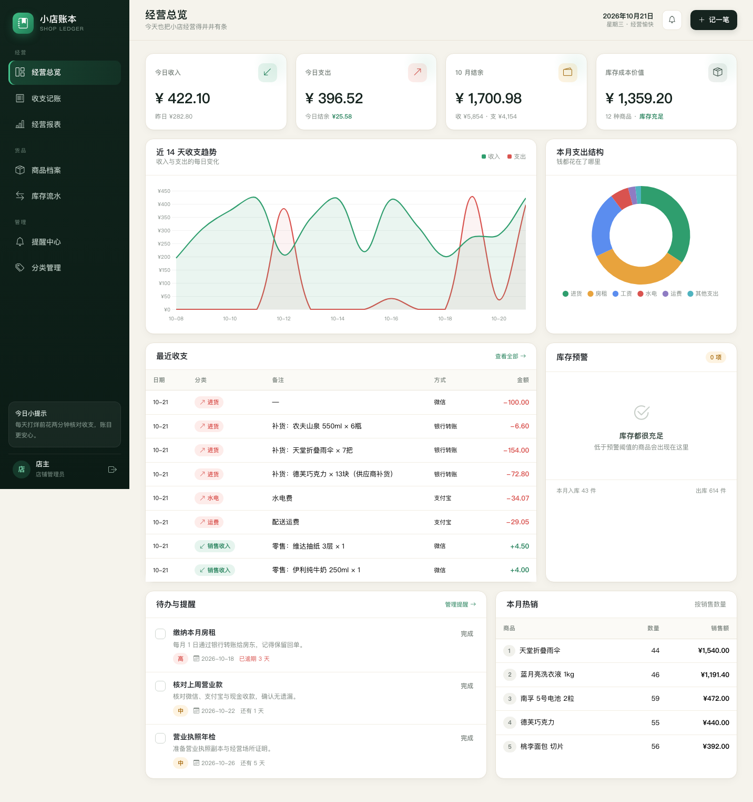
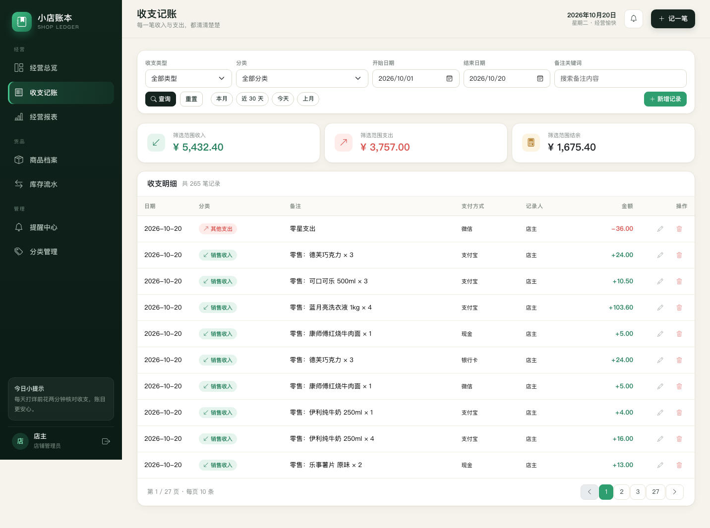
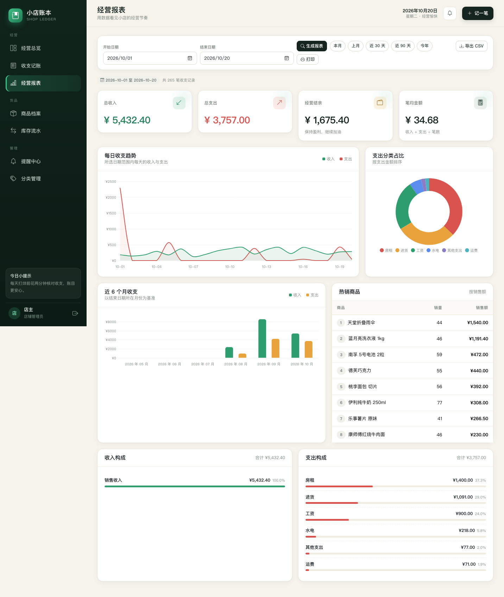
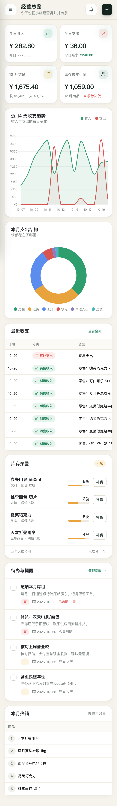

# 小店账本 · 小型店铺收支记账与库存管理系统

面向小便利店、杂货店、奶茶店等小型店铺的轻量级 Web 管理系统，覆盖**收支记账、商品档案、库存流水、经营报表、提醒待办**五个核心场景。

项目使用 **Jakarta EE（Servlet + JSP + JDBC）** 开发，前端为本地化的 Bootstrap 5 + Chart.js，不依赖任何 CDN，可离线运行。

## 功能

- **经营总览**：今日收入/支出、本月结余、库存成本价值、近 14 天收支趋势、本月支出结构、最近收支、库存预警、待办提醒、本月热销。
- **收支记账**：收入/支出新增、编辑、删除；按类型、分类、日期、关键字筛选；本月快捷筛选；分页；金额汇总。
- **商品管理**：商品档案（SKU、分类、单位、进价、售价、库存、预警值）；新增/编辑/停用/删除；低库存筛选；毛利展示；新增商品可录入期初库存并自动生成入库流水。
- **库存管理**：入库、出库、盘点（ADJUST）；流水查询与分页；出库时可同步生成一笔“销售收入”；入库时默认同步生成一笔“进货支出”（计入今日支出与最近收支）；库存不足校验；库存成本与流水汇总。
- **报表分析**：日期区间汇总、每日收支趋势、支出构成、近 6 个月趋势、商品热销榜、收入/支出分类构成；一键导出 UTF-8 BOM 的 CSV（Excel 可直接打开）；支持打印。
- **提醒待办**：新增/编辑/删除提醒，设置截止日期与优先级，标记完成/恢复待办；总览可直接勾选完成；按待办/已完成/全部筛选；逾期高亮；库存恢复充足后，遗留的“补货”待办会自动完成；完成“房租”等与支出分类同名的提醒时，会提示本月该分类已记支出，并在条目下提供关联支出链接，避免重复记账。
- **分类管理**：收入/支出分类的新增、改名、排序、删除；已被使用的分类禁止删除、禁止修改收支类型。
- **每日模拟流水**：每天第一次访问时自动生成当天的零售收入与日常支出（同一天只生成一次），总览、收支列表和报表立即有数据；模拟销售会同时写入库存出库流水并扣减库存，库存流水与收支金额保持一致；补货默认同时记一笔“进货”支出。
- **账户与安全**：登录/退出、PBKDF2 密码哈希、会话 60 分钟、登录后更换 Session、AuthFilter 统一拦截、JSP 默认转义、预编译 SQL。

首次启动会执行建表脚本并写入一套演示数据（12 个商品、近 60 天收支与库存流水、5 条提醒）。之后每天首次访问会补齐当天的模拟收支；模拟销售会同步写入出库流水并扣减库存，真实库存仍可通过入库/出库/盘点维护。

## 界面预览

**经营总览**



**收支记账**



**经营报表**



**手机端**（侧栏自动收起，表格支持横向滑动）



## 技术栈

| 层次 | 技术 |
| --- | --- |
| Web 层 | Jakarta Servlet 6.0、JSP 3.1、JSTL 3.0、Filter、Listener |
| 持久层 | JDBC、HikariCP 6.3.0、MySQL Connector/J 8.0.33 |
| 数据库 | MySQL 5.7 / 8.x / 9.x |
| JSON | Gson 2.10.1 |
| 前端 | Bootstrap 5.3.3、Bootstrap Icons 1.11.3、Chart.js 4.4.1（全部本地静态资源） |
| 构建 | Maven 3.6+，打包为 WAR |
| 运行 | **Tomcat 10.1.x**（`jakarta.servlet`），JDK 17+（开发机使用 JDK 24） |

> 本项目使用 `jakarta.*` 命名空间，要求 Tomcat 10.1+；Tomcat 9 及更早版本使用 `javax.*`，不能直接部署。

## 系统架构

```text
浏览器
  │
  ├─ EncodingFilter（UTF-8）
  ├─ AuthFilter（登录拦截）
  │
  ▼
Servlet（Dashboard / Transaction / Product / Stock / Report / Reminder / Category）
  │
  ▼
Service（业务规则、统计、演示数据、每日模拟流水）
  │
  ▼
DAO（JDBC + 预编译 SQL）
  │
  ▼
MySQL（HikariCP 连接池）

视图层：JSP + JSTL + Bootstrap 5 + Chart.js
```

项目采用原生 Servlet/JSP MVC，没有引入 Spring、Struts、JPA 等框架。Java EE（现 Jakarta EE）在这里是一组 Web 规范，而不是某个具体框架。

## 目录结构

```text
小型店铺收支记账与库存/
├── pom.xml
├── README.md
├── database/
│   └── init.sql                 # 建库、建专用账号、授权
├── docs/
│   └── screenshots/             # 界面截图
└── src/main/
    ├── java/com/shopledger/
    │   ├── model/               # User / Category / Transaction / Product / StockMovement / Reminder
    │   ├── dao/                 # JDBC 数据访问
    │   ├── service/             # 业务逻辑、统计报表、演示数据
    │   ├── util/                # Db、PasswordUtil、WebUtil、Page、JsonUtil
    │   └── web/                 # Servlet、Filter、Listener
    ├── resources/
    │   ├── db.properties.example # 数据库配置模板（复制为 db.properties）
    │   ├── db.properties         # 本地配置，包含密码，不提交
    │   └── schema.sql            # 建表脚本（应用启动时自动执行）
    └── webapp/
        ├── assets/              # 本地 Bootstrap / Icons / Chart.js / 自定义样式脚本
        └── WEB-INF/
            ├── web.xml
            └── views/           # JSP 页面
```

## 快速开始

### 1. 环境要求

- JDK 17 或更高版本（开发机为 JDK 24.0.2）
- Maven 3.6+
- MySQL 5.7+（已在 MySQL 9.x 验证）
- Tomcat 10.1.x（已用 Tomcat 10.1.55 验证）

### 2. 获取代码

```bash
git clone https://github.com/zsj4416/shop-ledger.git
cd shop-ledger
```

### 3. 初始化数据库

先复制配置模板：

```bash
cp src/main/resources/db.properties.example src/main/resources/db.properties
```

打开 `database/init.sql`，把两处 `CHANGE_ME` 换成自己的数据库密码；再打开 `db.properties`，填写**同一个密码**：

```properties
jdbc.url=jdbc:mysql://localhost:3306/shop_ledger?useUnicode=true&characterEncoding=utf8&serverTimezone=Asia/Shanghai&useSSL=false&allowPublicKeyRetrieval=true
jdbc.username=shop_ledger_app
jdbc.password=你的密码
```

然后用 MySQL 管理员执行初始化脚本：

```bash
mysql -uroot -p < database/init.sql
```

脚本会创建：

- 数据库 `shop_ledger`（utf8mb4）
- 专用账号 `shop_ledger_app`（`localhost` 和 `127.0.0.1`）
- 仅对 `shop_ledger.*` 的 `SELECT / INSERT / UPDATE / DELETE / CREATE / ALTER / INDEX / REFERENCES` 权限

数据库和表由应用自动初始化：库已存在时执行 `schema.sql` 建表；库不存在时，如果账号有建库权限，也会自动创建。使用上面的专用账号时，数据库已经由管理员创建，应用只需要建表权限。

> `db.properties` 已加入 `.gitignore`，不要提交真实密码。仓库里只保留 `db.properties.example`。

### 4. 构建

```bash
mvn clean package
```

产物：`target/shop-ledger.war`。

> 如果 Maven 使用了 JRE 而不是 JDK，会提示 “No compiler is provided in this environment”，请把 `JAVA_HOME` 指向 JDK，例如：
> `export JAVA_HOME=/Library/Java/JavaVirtualMachines/jdk-24.jdk/Contents/Home`

### 5. 部署到 Tomcat 10.1

把 `target/shop-ledger.war` 复制到 Tomcat 的 `webapps/` 目录，启动 Tomcat：

```bash
cp target/shop-ledger.war "$CATALINA_HOME/webapps/"
"$CATALINA_HOME/bin/startup.sh"
```

访问 <http://localhost:8080/shop-ledger/>。

### 6. 在 IntelliJ IDEA 中运行

1. `File → Open`，选择本项目的 `pom.xml`（或项目根目录），以 Maven 项目打开。
2. `File → Project Structure → Project`，SDK 选择 **JDK 17 或更高**（开发机为 24），Language level 选择 **17**。
3. 确认 `src/main/resources/db.properties` 已按上面的步骤创建。
4. 等待 Maven 依赖下载完成（`pom.xml` 右键 → Maven → Reload project）。
5. 新建 Tomcat 运行配置：
   - Application server：**Tomcat 10.1.55**；
   - Deployment：`shop-ledger:war exploded`；
   - Application context：`/shop-ledger`；
   - HTTP port：`8080`。
6. 启动后访问 `http://localhost:8080/shop-ledger/`。

> `.idea/` 不提交到 Git，因此从 GitHub 克隆后需要按上面步骤手动添加 Tomcat 运行配置。

### 7. 默认账号

| 用户名 | 密码 |
| --- | --- |
| `admin` | `admin123` |

首次登录后可在数据库 `users` 表中替换账号（密码使用 PBKDF2 哈希，建议通过代码生成，不要直接存明文）。

## 使用提示

- **记一笔**：顶栏「记一笔」或收支页右上角「新增收支」。
- **入库/出库**：库存页「入库 / 出库 / 盘点」。入库默认勾选“同时记一笔进货支出”，会按进价 × 数量写入“进货”支出，今日支出和最近收支立即变化；出库时可勾选“同时记一笔销售收入”联动记账。
- **每日模拟数据**：每天第一次打开系统时自动生成一批零售收入和日常支出，让演示数据不会出现“今日 0 元”；同一天刷新或重启不会重复生成。
- **库存预警**：商品库存 ≤ 预警值时，会出现在总览与库存页的预警区，可直接点「补货」跳转到入库弹窗。
- **报表导出**：报表页选择日期区间后点「导出 CSV」，文件带 BOM，Excel 打开中文不乱码。
- **数据重置**：停止应用后执行 `DROP DATABASE shop_ledger;`，再次启动会重新建库并写入演示数据。

## 数据库表

`users`、`categories`、`transactions`、`products`、`stock_movements`、`reminders`、`settings`，均为 InnoDB + utf8mb4，字段、索引与外键见 `src/main/resources/schema.sql`。

## 安全说明

- 数据库密码只保存在本地 `db.properties`，该文件不会提交到 Git。
- 仓库中的 `database/init.sql` 和 `db.properties.example` 使用 `CHANGE_ME` 占位，使用前必须替换。
- 应用密码使用 PBKDF2 哈希存储，登录后更换 Session，所有 SQL 使用预编译参数。
- 如果要把项目公开，请不要在 README、截图或提交记录中出现真实数据库密码。
- 生产环境建议通过环境变量或容器 Secret 注入数据库配置，而不是把密码写进 WAR。

## 常见问题

**Q：部署后 404，或启动报 `ClassNotFoundException: jakarta.servlet.*`？**

Tomcat 版本不对。请使用 **Tomcat 10.1.x**；Tomcat 9 使用的是 `javax.servlet`，不能部署本项目。

**Q：启动报“数据库初始化失败”或“Access denied”？**

检查：

1. MySQL 是否已启动；
2. 是否执行过 `database/init.sql`；
3. `db.properties` 中的用户名、密码是否与 SQL 中一致；
4. 数据库 `shop_ledger` 是否存在。

**Q：8080 端口被占用？**

修改 Tomcat `conf/server.xml` 中的 Connector 端口，或停止占用 8080 的进程。

**Q：页面中文乱码？**

项目已统一 UTF-8；请确认数据库、Tomcat 连接器和 JSP 都使用 UTF-8，且 `db.properties` 中的 `characterEncoding=utf8` 未被改掉。

## 已验证项

已在 Tomcat 10.1.55 + JDK 24.0.2 + MySQL 9.x 环境完成：

- 登录/退出、未登录拦截、登录后跳回原页面、404 错误页；
- 总览、收支、商品、库存、报表、提醒、分类全部页面渲染；
- 收支新增/修改/删除，商品新增（含期初库存）/停用/删除保护，入库/出库/盘点，出库联动收入，入库联动“进货”支出，提醒新增/完成/删除，分类新增/修改/删除保护；
- 每日模拟流水：首次访问自动生成、同日重复访问不重复生成、模拟销售同步生成库存出库流水并扣减库存、补货后今日支出增加且最近收支出现“补货：…”记录；
- 待办：总览直接勾选/点“完成”可标记完成；库存恢复充足后，遗留的“补货”待办自动完成；完成房租提醒后会提示并链接到本月已记的房租支出；
- CSV 导出（UTF-8 BOM）、分页与筛选、Chart.js 数据注入；
- `mvn package` 构建通过；
- 桌面端（1440px）与手机端（390px）截图检查，无控制台报错与横向溢出，手机端表格可横向滑动。

## 说明

本项目为课程/学习用途的 Java Web 实践项目，使用原生 Jakarta EE Web 技术实现，适合作为 Servlet/JSP/JDBC 综合练习。
